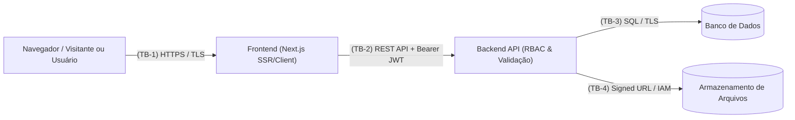

# Threat Model — Plataforma Digital (`QA-002`)

- **Issue de Qualidade:** [`QA-002` (`plataforma-quality#2`)](https://github.com/UniSENAI-Sorocaba/plataforma-quality/issues/2)
- **Prioridade / Sprint / Estimativa:** `P0` / `Sprint S0` / `5 SP`
- **SPECs Cobertas:** Transversal (`SPEC-AUTH-001..004`, `SPEC-PI-001..004`, `SPEC-EXT-001..003`, `SPEC-PORTAL-001..002`)
- **Dependências:** `ADR-006` a `ADR-011`, `PG-004`
- **Baseline de Governança:** `governance-v0.1.0@379131e3fa7c0411d5055b14b6bb30dd0853a3b5`
- **Responsável:** Gustavo Henrique (`@GustavooGomess`)
- **Revisor Designado:** Gabriel Ribeiro (`@gabrrkl7`)

---

## 1. Ativos Críticos

| ID | Ativo | Descrição / Sensibilidade | SPECs Relacionadas |
| :--- | :--- | :--- | :--- |
| **AST-01** | **Conta e Identidade (CPF)** | Cadastro único por CPF, papéis (`ALUNO`, `DOCENTE`, `COORDENACAO`), estado `active`. | `SPEC-AUTH-001`, `SPEC-AUTH-003` |
| **AST-02** | **Credenciais e Senha** | Hash de senha, flag `mustChangePassword`, tokens de recuperação. | `SPEC-AUTH-001`, `SPEC-AUTH-004` |
| **AST-03** | **Sessão e Tokens** | `accessToken` (curta duração), `refreshToken` rotativo e `familyId`. | `SPEC-AUTH-002` |
| **AST-04** | **Projetos e Propostas (PI)** | Propostas em rascunho/publicado, notas, rubricas e vínculos de equipe. | `SPEC-PI-001`, `SPEC-PI-003` |
| **AST-05** | **Extensão e Horas** | Editais, inscrições, horas submetidas e validações docentes. | `SPEC-EXT-001`, `SPEC-EXT-002` |
| **AST-06** | **Arquivos e Entregáveis** | PDFs, DOCXs e imagens (podendo conter menores de idade). | `SPEC-PI-004` |
| **AST-07** | **Certificados** | Certificados emitidos, hash de integridade e código QR de verificação. | `SPEC-EXT-003` |
| **AST-08** | **Conteúdo Público (Portal)** | Catálogo público de projetos aprovados/publicados e avisos gerais. | `SPEC-PORTAL-001`, `SPEC-PORTAL-002` |

---

## 2. Fronteiras de Confiança (*Trust Boundaries*)

- **TB-1 (Internet ↔ Frontend):** Tráfego público e autenticado; exige TLS, headers de segurança (`CSP`, `HSTS`, `X-Frame-Options`) e sanitização de inputs.
- **TB-2 (Frontend ↔ Backend API):** Fronteira de autorização. Ocultar menu na UI não substitui validação server-side (`RBAC` e escopo de projeto).
- **TB-3 (Backend ↔ Banco de Dados):** Acesso restrito à API; dados sensíveis mascarados em logs e trilhas de auditoria.
- **TB-4 (Backend ↔ Armazenamento):** Acesso apenas via URLs assinadas com expiração curta e verificação de permissão/vínculo.

---

## 3. Matriz de Ameaças, Controles, Risco Residual e Owners (`ADR-006..011`)

| ID | Fronteira / Ativo | Ameaça Concreta (STRIDE) | Controle Mitigador | Risco Residual | Owner | Issue / SPEC |
| :--- | :--- | :--- | :--- | :--- | :--- | :--- |
| **THR-01** | TB-1 / AST-02 | **Enumeração de contas** na recuperação de senha | Resposta HTTP 200 e mensagem neutra idêntica; rate limiting | Baixo | Backend | `AUTH-10-QA` (#32) / `SPEC-AUTH-001` |
| **THR-02** | TB-2 / AST-03 | **Reutilização de Refresh Token** roubado (*Replay*) | Refresh rotativo; detecção de reuse revoga toda a `familyId` | Baixo | Backend | `QA-008` (#8) / `SPEC-AUTH-002` |
| **THR-03** | TB-2 / AST-01, AST-04 | **Escalação de privilégio / IDOR** por link direto na API | RBAC server-side por papel e vínculo de projeto (`403`) | Baixo | Backend / Frontend | `QA-009` (#9), `AUTH-08-QA` (#31) / `SPEC-AUTH-003` |
| **THR-04** | TB-4 / AST-06 | **Acesso indevido ou upload malicioso** de arquivos | Validação de tipo/tamanho, URL assinada expirável e autorização | Médio *(aguarda limite de tamanho)* | Backend / Cloud | `QA-014` (#14) / `SPEC-PI-004` |
| **THR-05** | TB-1 / AST-07 | **Adulteração de certificado** ou consulta de revogado | Verificação criptográfica por hash/QR e bloqueio de revogados | Baixo | Backend | `QA-017` (#17) / `SPEC-EXT-003` |
| **THR-06** | TB-2 / AST-08 | **Vazamento de dados privados / rascunhos** no Portal | Filtro estrito de projetos publicados e omissão de notas/horas | Baixo | Backend / Frontend | `QA-018` (#18), `PORTAL-01-QA` (#33) / `SPEC-PORTAL-001` |
| **THR-07** | TB-3 / AST-01..05 | **Falta de trilha de auditoria** e exposição de segredos em log | Mascaramento (`[REDACTED]`) e revisão de retenção/auditoria | Médio *(divergência Caderno Item 65)* | Governança / PO | `QA-022` (#22) / `PG-006` |
| **THR-08** | TB-1, TB-2 / Todos | **Vulnerabilidades SAST/SCA/DAST** em código ou infra | Gates automatizados em PR (`Gitleaks`, `SAST/SCA`, `OWASP ZAP`) | Baixo | Quality / DevOps | `QA-006` (#6), `QA-025` (#25), `QA-026` (#26) |
